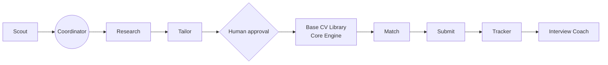

# Relay: an autonomous job application system

Relay finds relevant roles, tailors a truthful one page CV for each one and submits the application, while a person approves every content change.

## The problem

Job hunting means repeating the same work for every posting: searching, rewriting the CV and filling in forms. AI tools speed up the writing, but they tend to invent experience the candidate never had.

## How it works

1. **Find.** Scan LinkedIn, job boards and careers pages for roles that fit.
2. **Tailor.** Build a one page CV from verified facts and check every line before export.
3. **Apply.** Score the fit and submit through the right channel: a board, a careers site or email.

A person approves every change to CV content before it is used.

## Architecture



The agents are built and orchestrated on Grok Bot, with each role defined in [agents/](agents/README.md). This repository contains the Core Engine, written in Node.js.

## Engineering decisions

- **One responsibility per agent**, so failures are easy to locate and each agent improves on its own.
- **Facts as the single source of truth:** every CV line traces back to the master data file.
- **Hard gates that refuse to output:** a failed check means no PDF, and a person approves every deviation from base text.
- **Deterministic checks in code** for grounding, skills, length, banned phrases and page fit, so results are repeatable.

## Stack

Node.js, Puppeteer, HTML/CSS.

## Quick start

```bash
npm install
cp data/master-data.example.json data/master-data.json
./run.sh test/sample-content.json
```

See [WORKFLOW.md](WORKFLOW.md) for the content schema, checks and outputs.
